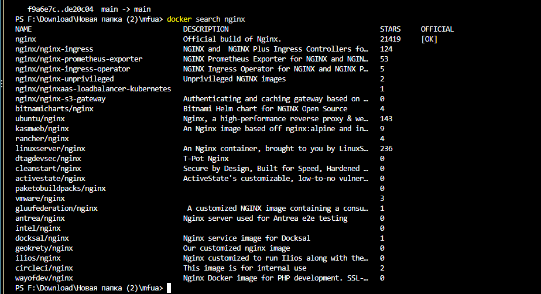
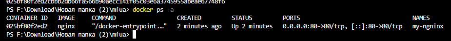
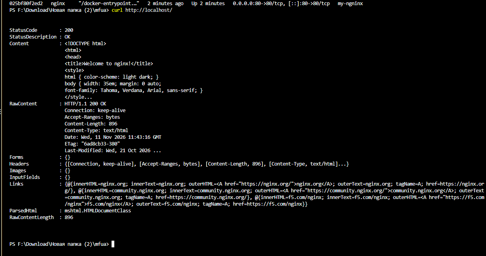
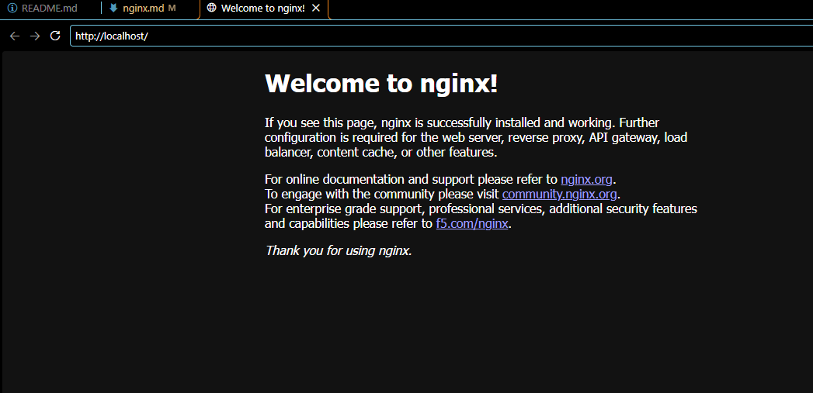
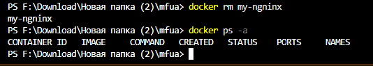
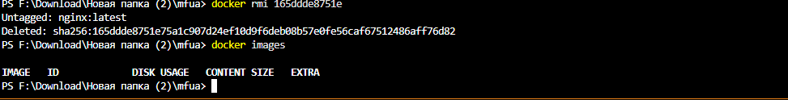

### 3. Получение готового образа Nginx

1. Поиск и получение готового образа на Docker Hub
1. Создание и запуск контейнера из полученного образа
1. Проверка состояния приложения из Docker-контейнера
1. Управление контейнером

Найти нужный образ на **Docker Hub**
```shell
docker search nginx
```



Так же готовый образ можно искать в **Docker Desktop**

Получить, создать и запустить Nginx
```shell
docker run -d --name my-nginx -p 80:80 nginx
```

`docker run` объединяет команды `docker pull`, `docker create` и `docker start`

Если запуск контейнера не удался, то проверьте уже созданные контейнеры с таким именем у себя
```shell
docker ps -a
```



Показать загруженный на ваш компьютер образ
```shell
docker images
```

Показать работающий Nginx

Способ 1
```shell
curl http://localhost/
```



Способ 2 - [открыть http://localhost/ адрес в браузере](http://localhost/)



Опционально, если нужно только получить готовый образ, без создания и запуска контейнера, то
```shell
docker pull nginx
```

Получить информацию по загруженному образу:
```shell
docker inspect nginx
```

При необходимости остановить контейнер с таким именем:
```shell
docker stop my-nginx
```

Проверьте остановленное приложение в браузере по тому же адресу, обновив страницу по `Ctrl+R` или `F5`

Перезапустить контейнер по имени
```shell
docker restart my-nginx
```
Перезапустить контейнер по его **id**
```shell
docker restart id_контейнера
```
Перед удалением нужно остановить указанный контейнер
```shell
docker stop my-nginx
```

Опционально можно удалить выбранный контейнер по его имени
```shell
docker rm my-nginx
```



Если нужно создать ещё один контейнер из этого образа, то:
```shell
docker run -d --name nginx-my -p 81:80 nginx
```

> изменить имя и порт приложения!

[Открыть в браузере приложение из 2-го контейнера по адресу http://localhost:81/](http://localhost:81/)

И можно удалить ещё и образ загруженного ранее **Nginx**:

Получить id образа
```shell
docker images
```

Опционально можно удалить по `id` нужный образ
```shell
docker rmi id_образа
```

