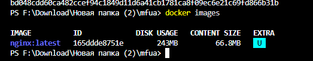
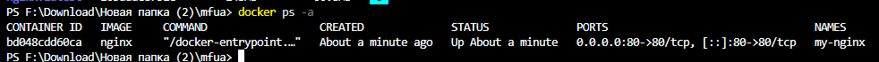

### 4. Проверить работу контейнера

Можно снова установить и запустить Nginx (если его удаляли ранее)
```shell
docker run -d --name my-nginx -p 80:80 nginx
```

Показать наличие загруженного файла образа
```shell
docker images
```



Показать только запущенные контейнеры
```shell
docker ps
```
или показать все контейнеры (в т.ч. остановленные)
```shell
docker ps -a
```


> Из одного образа можно получить несколько контейнеров!