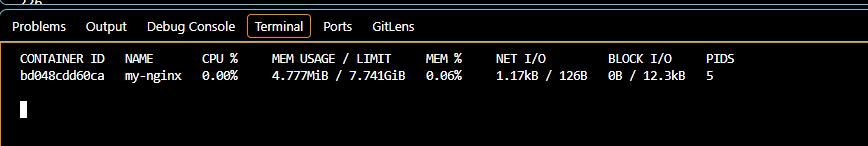
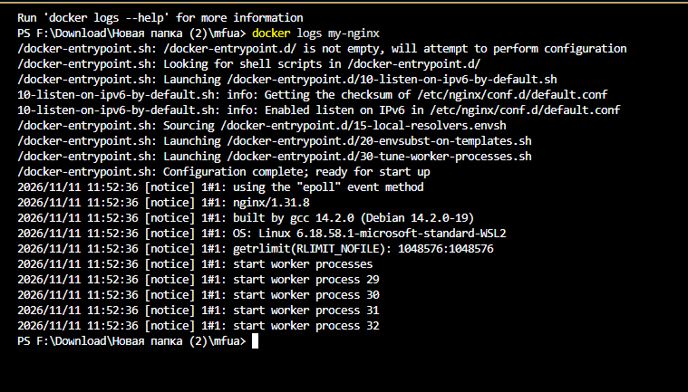
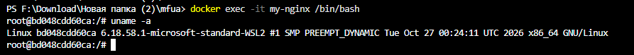
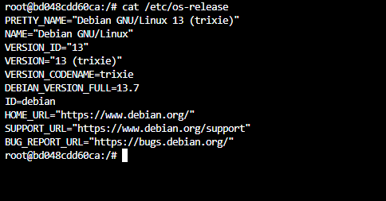
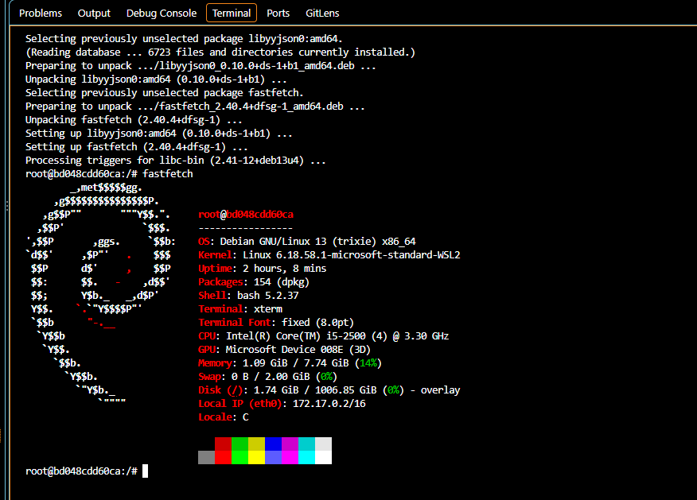
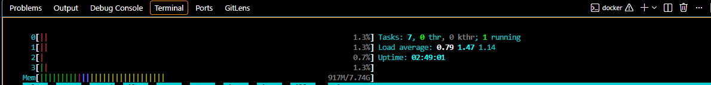
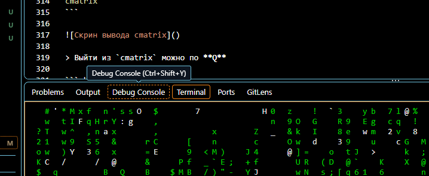
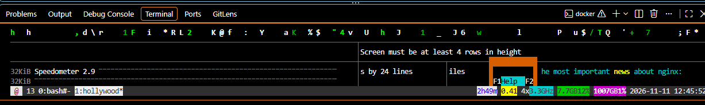
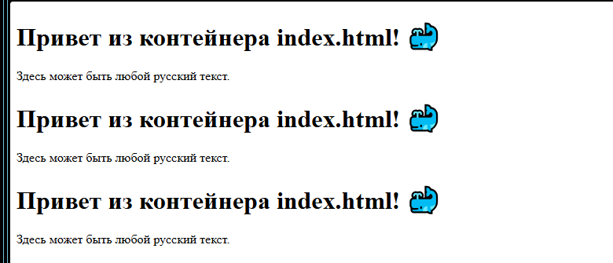

### 5. Управление контейнером

#### Мониторинг контейнеров

Показать состояние всех контейнеров
```shell
docker ps -a
```

Показать подробности о контейнере
```shell
docker inspect my-nginx
```

Запустить мониторинг контейнеров
```shell
docker stats
```




> Выйти из мониторинга контейнеров можно по `Ctrl+C`

Получить лог контейнера
```shell
docker logs my-nginx
```

Показать логи в режиме ожидания
```shell
docker logs -f my-nginx
```
> Выйти из логов в режиме ожидания можно по `Ctrl+C`



#### Управление контейнером

Остановить контейнер
```shell
docker stop my-nginx
```

Снова запустить контейнер
```shell
docker start my-nginx
```

Перезапустить контейнер
```shell
docker restart my-nginx
```

Зайти в контейнер
```shell
docker exec -it my-nginx /bin/bash
```
или
```shell
docker exec -it my-nginx bash
```
или
```shell
docker exec -it my-nginx /bin/sh
```
или
```shell
docker exec -it my-nginx sh
```

внутри контейнера можно повыполнять некоторые команды Linux
Получить информацию об ОС контейнера
```shell
uname -a
```


Получить больше информации об ОС контейнера
```shell
cat /etc/os-release
```


Установить **Fastfetch**
```shell
apt update && apt install -y fastfetch
```
> apt update - обновит списки источников приложений, apt install - установит указанное приложение
Запустить **Fastfetch**
```shell
fastfetch
```


Можно установить ещё несколько приложений внутри Docker-контейнера:
```shell
apt update && apt install -y fastfetch htop inxi cmatrix hollywood caca-utils mc micro
```
> На все вопросы ответьте `1` и `Enter`

и позапускать их отдельно друг от друга:
```shell
htop
```



> Выйти из `htop` можно по **Q**

```shell
cmatrix
```



> Выйти из `cmatrix` можно по **Q**

```shell
hollywood
```


> Выйти из `hollywood` можно по `Ctrl-C`

Выйти из контейнера можно командой `exit`

Отредактировать текст страницы приветствия **Nginx** (Находится в разработке!)

Если вы случайно вышли из контейнера, то снова выполните вход:
```shell
docker exec -it my-nginx /bin/bash
```
Открыть файл `index.html` для редактирования содержимого
```shell
micro /usr/share/nginx/html/index.html
```
Файл index.html
```html
<!DOCTYPE html>
<html>
<head>
    <meta charset="UTF-8">
    <title>Приветственная страница index.html</title>
</head>
<body>
    <h1>Привет из контейнера index.html! 🐳</h1>
    <p>Здесь может быть любой русский текст.</p>
</body>
</html>
```
отредайтируйте и сохраните по `Ctrl+S` и выйти из режима редактирования по `Ctrl+Q`

[Проверить изменения на открытой странице >>](http://localhost/)


Выйти из контейнера:
```shell
exit
```

Остановить все запущенные контейнеры
```shell
docker stop $(docker ps -q)
```

Удалить все остановленные контейнеры
```shell
docker container prune $(docker ps -q)
```

Удалить все образы
```shell
docker rmi $(docker images -q)
```
